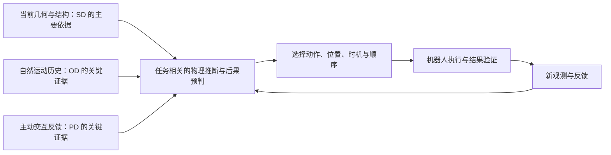

# ForesightBench：研究动机、评测缺口与实验设计

> 研究构思稿，更新于 2026-10-26。本文以 [ExperimentsBoard.txt](ExperimentsBoard.txt) 中的六个任务族、十八个难度设置为当前范围，参考 [ForesightBench_idea.md](ForesightBench_idea.md) 的总体定位。文中的新增评测协议、数据标注和实验假设属于后续设计建议；采集完成与模型评测完成分别统计。

## 1. 我们希望回答什么问题

**ForesightBench 的目标是评估机器人能否获取与任务有关的物理证据，预判物理过程和行动后果，并据此做出有效决策。** 我们将这一能力称为 **Decision-Relevant Physical Intelligence，决策相关物理智能**。

在真实操作中，一条语言指令通常只规定目标，没有给出完成目标所需的全部物理信息。例如，“接住小球”没有告诉机器人小球会从哪一侧落下、何时到达；“找出异常方块”没有直接标明哪个物体的摩擦系数不同；“让球进入洞口”也没有给出斜板的位置、反弹板的角度以及应当先移开的障碍。

机器人需要在行动前和行动过程中回答三个问题：

1. **我已经知道什么，还缺少什么物理信息？** 当前画面、运动历史和机器人状态分别提供了哪些证据？
2. **在这些条件下，世界接下来会怎样变化？** 小球会落在哪里，何时经过可操作区域，不同物体的交互响应有何差异？
3. **我的选择会带来什么后果？** 应当移动哪个物体、调整到什么位置、何时行动，以及是否需要先完成一个准备步骤？

因此，ForesightBench 关注的能力链条是：

> **获取物理证据 → 推断任务相关状态 → 预判过程与后果 → 选择动作、时机和顺序 → 执行并验证结果。**

最终成功率是这条链条的整体结果。我们还希望通过受控实验解释：模型利用了哪些证据，哪些信息改变了决策，失败又发生在哪个环节。

## 2. 研究出发点：任务完成表现与物理理解之间还需要证据

### 2.1 通用操作评测已经建立了重要基础

现有机器人 benchmark 推动了多任务学习、操作泛化、双臂协作和可复现评测。例如，[LIBERO](https://github.com/Lifelong-Robot-Learning/LIBERO) 围绕终身学习中的知识迁移构建任务体系；[RoboTwin 2.0](https://arxiv.org/abs/2506.18088) 提供双臂任务、自动数据生成和域随机化；[RoboDojo](https://arxiv.org/abs/2607.04434) 将仿真与真实机器人评测结合，覆盖泛化、记忆、精度、长程执行和开放词汇指令等能力。

这些进展让机器人能否完成多样操作成为可比较的问题。在此基础上，我们进一步追问：**当正确决策依赖运动状态、隐藏属性或未来物理后果时，任务成功能否被归因于对这些信息的有效利用？**

### 2.2 一个成功轨迹可能有多种解释

以接球为例，模型成功接住小球，可能是因为它根据运动历史预测了落点，也可能是因为训练和测试中的落点集中在固定区域。以异常物体分拣为例，正确分类可能来自交互反馈，也可能来自颜色、编号、初始位置或渲染细节与标签的偶然相关性。

这些是评测设计中需要检验的可能机制。仅凭一条成功轨迹，难以区分它们。

ForesightBench 的出发点是让关键物理因素成为可控制、可干预、可分析的变量：改变它们应当产生可验证的运动差异，或使正确决策发生变化。随后检查模型是否做出相应调整。

### 2.3 简单物体可以承载明确的科学问题

当前任务主要使用小球、方块、斜板、反弹板和单摆。这些物体便于构造清晰的物理过程，也便于改变单个因素、自动记录结果和复现失败。

它们分别对应一些常见操作需求：运动目标接取、借助环境实现间接操作、在有限时间窗口内干预，以及通过交互完成质量检测。当前六个任务族提供的是这些能力的诊断场景，对真实生产或家庭操作的推广仍需要后续验证。

## 3. 现有 benchmark 覆盖了什么，我们希望补充什么

物理推理、动态操作和主动交互已经有相关研究。ForesightBench 的定位需要建立在具体的评测协议上。下表左侧概括公开工作的目标，右侧是本项目希望进一步研究的问题。

| 代表工作 | 已有评测重点 | ForesightBench 希望进一步回答的问题 |
|---|---|---|
| [LIBERO](https://github.com/Lifelong-Robot-Learning/LIBERO) | 多任务与终身机器人学习中的知识迁移，包括空间、物体和目标等任务变化 | 当任务目标相同、决定正确行动的物理因素变化时，模型能否利用必要证据调整决策？ |
| [RoboTwin 2.0](https://arxiv.org/abs/2506.18088) | 可扩展的双臂操作数据生成、域随机化和操作鲁棒性 | 如何在外观泛化之外，单独测量动力学变化、属性辨识和后果预判对决策的影响？ |
| [RoboDojo](https://arxiv.org/abs/2607.04434) | 结合仿真与真实环境，从多个能力维度综合评价通用操作策略 | 如何把一个任务的表现进一步归因到物理证据获取、决策选择和动作执行？ |
| [DOMINO / PUMA](https://h-embodvis.github.io/DOMINO/) | 动态操作评测；PUMA 结合历史运动线索与未来状态预判 | 在动态操作基础上，如何通过统一的证据干预协议，比较自然观察、主动属性辨识与动作后果推演？ |
| [IMBench](https://arxiv.org/html/2607.15641v1) | 整合物理理解、动作提议和执行；包含动力学、因果、隐藏状态与主动发现等任务 | 如何围绕同一任务系统控制可用证据，并测量证据变化、物理因素变化与决策变化之间的关系？ |
| [Physion](https://physion-benchmark.github.io/) | 从视觉中预测物体如何运动与交互，并比较模型和人类的物理预测 | 对未来的预测是否能帮助机器人选对位置、时机和操作顺序，并最终完成任务？ |
| [PHYRE](https://ai.meta.com/tools/phyre/) | 在二维物理谜题中选择干预，考察物理推理和样本效率 | 在机器人观测、运动学、接触和执行延迟约束下，物理判断能否转化为可执行行为？ |

其中，**DOMINO 和 IMBench 是需要重点比较的近邻工作**。[DOMINO](https://h-embodvis.github.io/DOMINO/) 已经明确研究历史运动与未来预判；[IMBench](https://arxiv.org/html/2607.15641v1) 已经包含物理推理、主动发现和分阶段执行评价。任务中出现滚球、单摆或隐藏属性，本身不足以建立项目差异。

我们希望形成的特色是：**在一组可控的机器人任务中，系统研究“可获得什么物理证据—模型如何响应这些证据—最终决策是否正确”之间的关系。** 这一定位需要由下面的配对场景、信息消融和分层诊断共同支撑。

## 4. 我们重点解决的五个评测问题

### 4.1 任务成功能否归因于必要的物理信息

如果一个任务在不观察运动、不进行探测的情况下也能依靠固定策略获得高分，那么这个任务对相应能力的诊断价值有限。

例如，如果异常方块始终处于最左侧，分拣成功无法说明模型辨识了摩擦差异；如果接球垫覆盖所有可能落点，接球成功也无法说明模型准确预判了轨迹。

**设计要求：** 随机化与答案无关的外观和位置，构造会改变正确决策的物理变化，并设置缺少关键证据的对照条件。

### 4.2 外观泛化与物理泛化如何区分

更换背景、纹理或物体外形，可以检验视觉鲁棒性。改变坡度、摩擦系数、摆长、摆幅或初始运动状态，则可能改变实际物理过程，以及应当采取的行动。

**设计要求：** 分开报告外观变化、物理参数变化和参数组合变化下的结果。当前任务应优先使用已经实现并验证有效的变量，避免仅在构思中列出大量未经验证的属性。

### 4.3 模型是否会获取并使用信息

PD 任务中，机器人需要通过推动或抓取获得属性证据。这里至少包含两个可以分别评价的问题：选择的探测是否有效，以及得到反馈后是否正确使用了反馈。

如果所有演示都要求按固定顺序逐个探测，模型可以完成属性辨识，却未必表现出主动选择探测对象的能力。

**设计要求：** 区分固定探测后的属性识别与自主探测选择；只有存在不同信息价值或成本的可选动作，并记录相应成本时，才评价主动探测效率。

### 4.4 对物理变化的响应是否具有一致性

模型可能在常见布局中表现良好，却在反弹板位置、障碍关系或异常物体身份改变后继续复用原动作。

**设计要求：** 对相关场景进行配对，尽量保持无关条件一致，只改变预先指定的物理因素或结构因素。由仿真、专家或可验证的求解器确认正确行动如何变化，再检查模型的响应。

### 4.5 失败来自推断、决策还是执行

接球失败可能来自落点预测错误，也可能来自机械臂到达太慢；切绳失败可能来自时机选择错误，也可能来自刀具没有实际切断绳子。只报告最终成败，会混合这些原因。

**设计要求：** 保留最终成功率，同时记录关键事件；通过真实状态、正确决策和统一执行器等诊断条件，分析感知与推断、决策、低层控制分别造成的损失。这些诊断需要干预实验支持。

## 5. 统一框架：三种物理信息利用方式

三类任务按主要能力瓶颈划分，允许相互重叠。单个任务可以同时要求动力学推断、时机判断和多步规划。

| 类别 | 名称 | 主要问题 | 当前任务 |
|---|---|---|---|
| SD | **Simulate for Decision：后果推演驱动决策** | 在执行候选操作后，球的路径、接触关系和任务结果会怎样改变？ | SD1 斜板进洞；SD2 击球进洞 |
| OD | **Observe for Decision：运动观察驱动决策** | 从自然运动中能提取什么证据，应当在何处、何时干预？ | OD1 斜坡接球；OD2 单摆切绳 |
| PD | **Property for Decision：属性辨识驱动决策** | 如何通过交互辨识任务相关属性，再完成选择和分类？ | PD1 摩擦异常方块；PD2 尺寸异常小球 |

PD 沿用当前实验板的编号，英文统一写为 **Property for Decision**；原稿的 **Probe for Decision** 对应其主动交互机制。两者之间的关系是：探测产生属性证据，属性证据支持最终决策。

“Simulate”在这里表示对动作后果的行为要求。模型可以使用隐式表示、解析计算、学习到的预测器或显式仿真器。实验结论应依据行为和对照结果，避免仅从成功率推断模型内部一定存在某种世界模型。

这三类并不要求每条 episode 都依次经历观察、探测和推演。SD 的部分问题可以由充分的静态几何信息支持；OD 强调运动历史的作用；PD 强调通过交互补充属性证据。

## 6. 当前六个任务如何支撑研究目标

当前范围为 **3 类 × 2 个任务族 × 3 个难度 = 18 个实验设置**。同一任务族中的三个难度分别报告结果，同时保留任务族层面的分析。

### 6.1 SD1：斜板进洞——从几何布局推演运动后果

机器人需要摆放黄色斜块，使小球经过已有斜面与后续运动，最终落入目标区域。它需要考虑斜面的位置、朝向、球的运动路径和可能发生的碰撞。

| 难度 | 当前设置 | 增加的要求 |
|---|---|---|
| Easy | 斜块位于给定直线上，主要前后移动到合适位置 | 根据布局选择合适的放置位置 |
| Medium | 斜块初始位置和姿态随机，需要先旋转对齐再移动 | 联合考虑位置与朝向 |
| Hard | 增加可能挡路的方块，需要判断是否先清障 | 判断动作前提，安排清障与摆放顺序 |

**核心问题：** 模型能否把斜块摆放与球的未来路径联系起来，并在必要时先改变环境？

判定成功应以球最终进入目标区域为依据。将斜块移动到某个指定姿态，可以作为中间状态记录。

### 6.2 SD2：击球进洞——利用环境改变运动路径

小球与洞口之间存在遮挡，机器人需要利用弹力板构造可行路径。随着难度增加，弹力板的姿态也成为决策变量，最终涉及双臂分别调整两侧弹力板。

| 难度 | 当前设置 | 增加的要求 |
|---|---|---|
| Easy | 利用给定的侧方弹力板击球进洞 | 选择能够形成有效反弹路径的击球动作 |
| Medium | 弹力板初始姿态未知，需要先调整角度 | 将板的朝向与反弹结果联系起来 |
| Hard | 两侧弹力板均需调整，由双臂分别操作 | 协调多个几何变量与操作步骤 |

**核心问题：** 模型能否预测反弹后的路径，并据此安排环境配置和击球动作？

建议分别记录板的最终姿态、击球状态、碰撞位置和最终入洞结果，帮助区分路径设计与击打执行的错误。

### 6.3 OD1：大小球斜坡接球——根据运动过程预测干预位置

球经过斜面和间隙后落下，机器人需要及时移动接球垫。Medium 引入小球分支与下方斜板，使大小球的后续运动方向不同；Hard 进一步缩小接球垫。

| 难度 | 当前设置 | 增加的要求 |
|---|---|---|
| Easy | 大球经过两个斜坡，机器人判断落点并接取 | 预测运动结果并及时移动 |
| Medium | 增加小球分支和第三个斜板，大小球对应不同运动路径 | 识别路径分支，继续估计落点与到达时间 |
| Hard | 保留分支结构，缩小接球垫 | 提高空间预测与执行精度 |

**核心问题：** 模型是否利用早期运动信息，及时预测球的落点和到达时间？

球的大小可能从静态画面中直接判断，因此“选对左右方向”与“利用运动历史准确接球”应分别分析。Medium 到 Hard 主要增加容错要求，其性能差异需要结合执行误差解释。

### 6.4 OD2：单摆切绳——把周期观察转化为行动时机

机器人观察单摆后，在合适时刻切断绳子，使球落入指定区域。切断时的球位置和速度共同影响后续轨迹；使用刀具时，还要考虑机械臂运动和实际切断之间的延迟。

| 难度 | 当前设置 | 增加的要求 |
|---|---|---|
| Easy | 按按钮触发断绳 | 观察摆动规律并选择触发时机 |
| Medium | 使用已经放置好的刀具切绳 | 把时机判断转化为有执行延迟的接触动作 |
| Hard | 缩小目标垫子 | 提高对切断状态、时间和落点的精度要求 |

**核心问题：** 模型能否根据运动历史安排一次及时、有效的物理干预？

建议同时记录决策发出时刻、实际断绳时刻、断绳状态和最终落点，从而区分时间预判与工具操作造成的误差。

### 6.5 PD1：推动小方块——从运动响应辨识摩擦差异

外观相近的方块具有不同的摩擦属性。机器人通过推动后释放，利用后续滑动响应识别异常，再进行分拣。

| 难度 | 当前设置 | 增加的要求 |
|---|---|---|
| Easy | 三个方块位于同一起跑线，包含一个异常项 | 通过滑动响应比较属性 |
| Medium | 五个方块初始位置不同，包含一个异常项 | 比较释放后的相对位移，排除初始位置影响 |
| Hard | 五个方块中包含两个异常项，可能分别具有偏高、偏低的摩擦系数 | 识别异常并按属性方向分别分类 |

**核心问题：** 模型能否从可比较的交互响应中辨识摩擦差异，并完成正确分拣？

释放速度、接触方式、桌面条件和观测时长都会影响滑动表现，协议需要控制或记录这些变量。异常标签应明确对应摩擦系数相对于标准的偏高或偏低。

### 6.6 PD2：抓取小球——通过夹爪反馈进行尺寸辨识

机器人通过抓取比较小球尺寸，区分正常、偏大和偏小的物体，并放入相应区域。

| 难度 | 当前设置 | 增加的要求 |
|---|---|---|
| Easy | 提供标准小球作为参考 | 建立抓取反馈与正常尺寸之间的对应关系 |
| Medium | 不提供标准小球，需要通过多个小球的比较建立参照 | 在缺少显式标准的情况下识别异常 |
| Hard | 五个小球包含两个异常项，区分偏大与偏小 | 进行多对象比较与多类别分拣 |

**核心问题：** 交互提供的尺寸证据能否改善异常识别与分类？

尺寸本身可能从 RGB 中被识别，尤其在相机标定和深度线索充分时。该任务需要用视觉基线验证初始信息是否已经足够。如果视觉即可稳定完成，应将其定位为多模态尺寸辨识；若要研究必须交互才能解除的不确定性，则需进一步设计遮挡、视角或尺寸差异，并验证抓取反馈确实提供了额外信息。

## 7. 六个能力维度如何落到可测量行为

三类任务是任务组织方式；六个能力维度用于描述各任务的需求和分析模型表现。两者可以交叉。

| 维度 | 含义 | 可测量行为或诊断问题 |
|---|---|---|
| Dynamics | 动力学推断 | 能否预测运动方向、落点、速度变化或反弹后的路径？ |
| Timing | 时序与事件预判 | 能否在可行窗口内接球或切绳？提前量和实际触发误差是多少？ |
| Property | 属性辨识 | 能否依据允许的观测识别摩擦差异、尺寸差异及其方向？ |
| Probing | 主动探测选择 | 能否选择有效、必要且成本合理的交互？是否出现重复或无效探测？ |
| Structure | 结构关系理解 | 能否识别路径、障碍、斜板和反弹板之间的关系？ |
| Causality | 多步因果推理 | 能否安排清障、调整、击打等步骤，并预测对应事件顺序？ |

实验板中的 1–10 分可作为任务设计者对能力需求的初步标注。它们与模型实测成绩分开保存；在建立客观评分规则前，不直接据此生成模型能力雷达图，也不直接作为总分权重。

某些维度还需要额外诊断接口才能独立测量。例如，落点预测误差需要模型提供结构化预测，或增加独立的离线预测评测；标准动作策略仍可直接参加闭环成功率评测。

## 8. 支撑研究定位的评测协议

以下协议是在当前任务基础上建议补充的评测层。优先完成少量任务的完整诊断，再扩展到全部设置。

### 8.1 统一观测、动作与时间预算

沿用原稿提出的核心方向，优先使用多视角 RGB、机器人 qpos、夹爪状态与语言指令。具体字段、历史长度、控制频率和动作语义，以实际采集与模型适配验证结果为准。力觉、触觉等输入在采集链验证后单独定义扩展条件。

基线之间需要公开相同或明确可比的观测条件、控制器、动作限制和 episode 预算。动态任务还要报告仿真时间与推理时间的关系、动作分块长度和观测延迟。

真实物理参数、物体速度、接触关系等 simulator state 可用于标注与 oracle 诊断，在标准评测中的可见性应明确规定。

### 8.2 信息消融：关键证据是否改变表现

| 对照 | 适用范围 | 希望回答的问题 |
|---|---|---|
| 当前帧与运动历史 | 重点用于 OD | 运动历史是否改善了预测和行动？ |
| 不同观察长度 | OD | 模型需要多少证据，是否错过干预窗口？ |
| 初始观测与标准化探测后的观测 | PD | 交互反馈是否提高属性辨识与分类表现？ |
| 固定探测与自主探测 | 有探测选择空间的 PD 设置 | 模型能否在相同预算下选择更有效的探测？ |
| 仅视觉与视觉加夹爪/qpos 反馈 | 重点用于 PD2 | 本体与夹爪反馈实际提供了多少增益？ |
| 原始观测与真实物理状态诊断 | 各类任务 | 状态推断造成了多大性能差距？ |
| 自主决策与正确高层决策辅助 | 可定义高层动作的设置 | 提供正确位置、时机或步骤后，执行仍有多大困难？ |

信息消融应明确哪些输入被改变、哪些输入保持一致。例如，所谓“单帧”条件要说明是否保留循环隐状态、缓存和 qpos 历史；不同探测条件还要统一或单独报告时间、动作与反馈预算。

### 8.3 配对干预：模型是否对关键变化作出响应

建议优先构造以下配对：

- **SD1：** 改变障碍是否挡住必要路径，检验是否相应改变清障决策。
- **SD2：** 改变反弹板姿态、洞口或遮挡关系，检验是否调整板的配置与击球选择。
- **OD1：** 构造当前位置接近、速度或后续运动不同的状态，检验是否调整接取策略。
- **OD2：** 控制摆动状态或摆长等因素，检验是否调整切绳时机。
- **PD1：** 在无关外观与布局一致的条件下交换异常摩擦属性，检验分拣对象是否随之改变。
- **PD2：** 比较不同尺寸组合与参考条件；记录几何变化造成的视觉可辨性，并与交互反馈增益一起分析。

每组配对应记录干预变量、保持一致的因素，以及专家可行解如何变化。仅当两个场景确实要求不同决策时，才纳入“决策随干预改变”的统计。

原稿提出的 **physically aliased scenarios**，适合用于初始观测相同或近似、关键物理状态却不同的子集。对于几何信息充分的 SD 场景，可以采用结构变化与候选动作比较来诊断后果推演。

### 8.4 分开报告推理难度与执行容错

Easy、Medium、Hard 当前包含多种变化：新增分支或前置步骤、增加对象数量、取消参考，以及缩小目标区域。它们分别增加信息、规划、比较或精度要求。

建议为每个难度变化增加标签，例如“需旋转对齐”“需清障”“新增运动分支”“取消标准参照”“缩小目标”。这样可以解释性能下降具体对应什么要求，并通过专家成功率和控制上界验证难度设置的有效性。

## 9. 评价指标与实验组织

### 9.1 主结果：完整任务成功率

对全部十八个设置分别报告成功率，再给出任务族、类别和整体宏平均。整体宏平均对十八个设置等权；episode 数量不同不应自动改变某个设置的权重。

成功判据应对应实际目标：

- SD：球实际进入指定区域或洞口，并满足预先规定的操作约束。
- OD：在规定时间内成功接球，或切绳后球实际落入目标区域。
- PD：异常对象与类别识别正确，并完成规定放置；同时报告是否误分正常对象。

报告测试 seed、episode 数量和不确定性区间。对同一场景的消融与配对实验，优先采用配对统计；同源场景组在切分和重采样时作为一组处理。

### 9.2 诊断结果：证据、决策与执行

| 指标 | 用途 | 前提 |
|---|---|---|
| 历史信息增益 | 比较有无运动历史时的成功率或预测差异 | 明确其余输入与内部记忆条件 |
| 探测反馈增益 | 比较获得交互反馈前后的识别或分类表现 | 使用可比较的反馈和预算 |
| 属性识别准确率 | 判断异常项、偏大/偏小或高/低摩擦是否识别正确 | 有属性与对象标签 |
| 轨迹、落点与事件时间误差 | 分析动力学和时序预测 | 有真值及相应预测接口 |
| 决策正确率 | 判断清障选择、目标位置、时机或步骤是否可行 | 有验证过的可行解或容许范围 |
| 干预响应一致性 | 检验关键因素变化后决策是否正确变化 | 配对场景有明确决策差异 |
| 探测成本与冗余 | 分析信息获取效率 | 有可选探测和成本定义 |
| 执行误差与失败类型 | 区分预测、决策和操作问题 | 记录关键状态与事件 |

不要求每个基线额外生成自然语言解释才能参加主评测。需要结构化预测或高层决策输出的指标，作为独立诊断结果报告。

### 9.3 数据切分与泛化

建议至少区分三种测试条件：

1. **分布内新场景：** 参数范围与训练一致，初始状态和随机种子独立。
2. **物理泛化：** 在保持专家可解的前提下，测试未见过的参数区间或参数组合，例如坡度、摩擦系数、摆长与摆幅。
3. **结构与布局泛化：** 测试新的障碍位置、板的配置、对象位置或参考条件。

视觉泛化可以另外增加。由同一基础状态生成的配对场景、候选动作分支和观察长度变体应进入同一数据划分，避免训练与测试共享同源样本。

### 9.4 基线与研究问题

当前实验板列出的模型候选为 **Pi0.5、PUMA、StarVLA 的 Qwen VLA 和 ROT**。具体 checkpoint、训练预算、观测能力与适配状态需要在实际评测时记录，当前模型名单表示计划范围。

建议围绕以下问题组织实验：

| 研究问题 | 对应实验 | 结果应支持的判断 |
|---|---|---|
| RQ1：模型是否利用必要证据？ | 运动历史、探测反馈和夹爪状态消融 | 哪类信息提供了可重复的增益，哪些任务仍可被捷径完成？ |
| RQ2：模型是否适应关键物理变化？ | 配对干预与物理泛化测试 | 决策是否随物理状态和关系变化而调整？ |
| RQ3：主要瓶颈在哪里？ | 真实状态、正确决策辅助和统一执行诊断 | 性能损失主要来自状态推断、决策还是低层执行？ |
| RQ4：难度变化测到了什么？ | 难度标签、目标区域大小和控制上界分析 | 新增推理要求与容错收紧分别带来多大影响？ |

论文应根据实验结果形成结论。例如，“历史信息对 OD 有帮助”“主动探测仍存在效率瓶颈”“更小目标主要暴露执行误差”等，均属于需要验证的假设。

## 10. 预期贡献与当前需要补齐的证据

如果上述协议得到实现和验证，项目可以形成四项贡献：

1. **一个聚焦决策相关物理智能的机器人评测框架。** 以自然运动、交互属性和动作后果三种信息利用方式组织任务，并通过六个维度分析能力需求。
2. **一套六任务族、十八设置的可控实验场景。** 任务变量、难度来源、成功判据和失败事件均可追踪，支持闭环操作评测。
3. **一套围绕证据的诊断协议。** 结合信息消融、配对干预、物理泛化和分层辅助条件，分析模型依据什么做出决策。
4. **一组关于当前策略瓶颈的实证发现。** 在统一接口和预算下比较候选模型，解释观察、属性辨识、后果推演与执行各环节的表现。

当前优先补齐三类证据：**任务确实需要所声称的信息、关键变量的影响能够被稳定复现、不同模型在公平条件下可被比较。** 尤其需要验证 PD2 的视觉可辨性、PD1 探测条件的可比性，以及 OD 任务中的推理与执行延迟。

原稿中的倚门杯、支撑链、十五任务族规划，以及更广泛的传感器和真实机器人扩展，可以保留为后续方向。当前论文的主张应由这六个任务及其实际完成的协议支撑。

## 11. 可用于论文引言的中文草稿

机器人在真实环境中执行任务时，需要持续获取与目标相关的物理信息。接取运动物体要求判断未来的位置和到达时间；通过反弹或斜面实现间接操作要求预判环境配置带来的运动后果；质量检测则可能需要通过推动或抓取揭示物体属性。这些场景共同要求机器人将观察与交互中的证据转化为对未来的判断，并据此选择动作、时机和操作顺序。

现有机器人评测已经在多任务操作、泛化、动态交互和物理推理方面建立了重要基础。[LIBERO](https://github.com/Lifelong-Robot-Learning/LIBERO) 研究知识迁移，[RoboTwin 2.0](https://arxiv.org/abs/2506.18088) 关注可扩展双臂操作与域随机化，[DOMINO](https://h-embodvis.github.io/DOMINO/) 研究动态操作及历史运动与未来预判，[IMBench](https://arxiv.org/html/2607.15641v1) 则将物理理解、动作提议与执行纳入统一评价。在这些进展之上，仍值得系统研究的问题是：任务成功在多大程度上依赖必要物理证据的获取和利用，以及物理条件变化时模型是否做出了正确响应。回答这些问题，需要在最终成功率之外，对可用信息、物理因素和执行条件进行受控比较。

为此，我们设计 ForesightBench，聚焦决策相关的物理智能。当前任务体系包含 Simulate for Decision、Observe for Decision 和 Property for Decision 三类任务，共六个任务族、十八个难度设置，分别要求机器人推演环境配置的后果、从自然运动中提取决策证据，以及通过主动交互辨识属性。各任务将物理判断与机器人操作结合，最终以实际入洞、接取或分拣结果验证行动是否有效。

我们进一步围绕这些任务设计证据消融、配对物理干预和分层诊断协议，分析运动历史、交互反馈和后果预判对决策的作用，并区分状态推断、动作选择与执行造成的失败。通过这一评测体系，我们希望为理解和改进机器人的物理决策能力提供可解释、可复现的实验依据。

英文定位句：

> **ForesightBench evaluates whether robotic agents can acquire decision-relevant physical evidence, anticipate physical processes and action outcomes, and use that knowledge to choose effective actions.**
